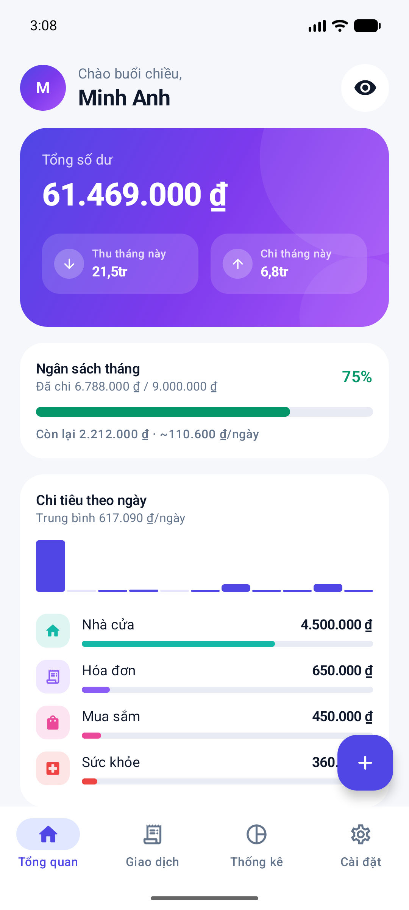
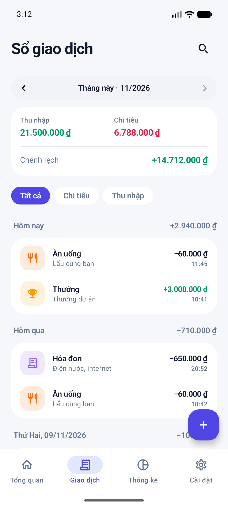
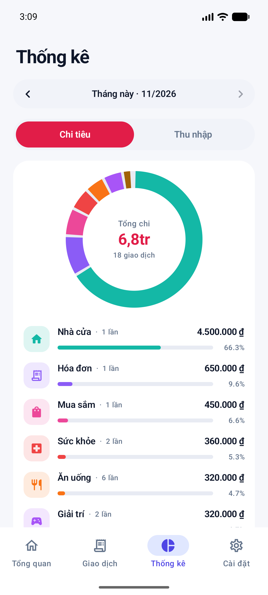
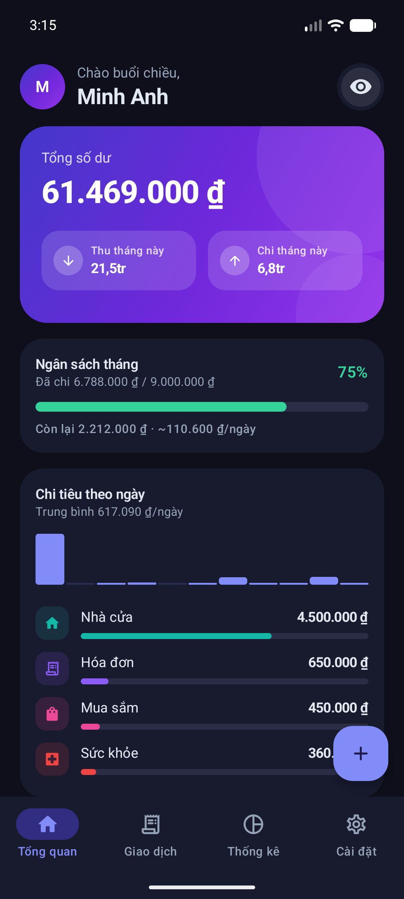

# 💰 Chi Tiêu — Ứng dụng quản lý chi tiêu cá nhân cho Android

Ứng dụng ghi chép thu chi gọn nhẹ, giao diện hiện đại (Material 3, hỗ trợ Sáng/Tối), viết hoàn toàn bằng **Kotlin + Jetpack Compose**. Dữ liệu lưu **cục bộ trên máy**: không cần tài khoản, không quảng cáo, không gửi dữ liệu đi đâu.

<p align="center">
  
  
  
  
</p>

## ✨ Tính năng

| | |
|---|---|
| 🏠 **Tổng quan** | Thẻ số dư dạng gradient, thu/chi tháng này, biểu đồ chi tiêu theo ngày, top danh mục, giao dịch gần đây |
| ➕ **Thêm/Sửa giao dịch** | Nhập số tiền tự định dạng `1.250.000 ₫`, nút cộng nhanh (+10K, +50K…), 21 danh mục có icon & màu riêng, chọn ngày, ghi chú |
| 📒 **Sổ giao dịch** | Lọc theo tháng, theo loại Thu/Chi, tìm kiếm **không dấu** ("an uong" → "Ăn uống"), nhóm theo ngày, **vuốt để xóa** kèm **Hoàn tác** |
| 📊 **Thống kê** | Biểu đồ vành khuyên theo danh mục, % từng danh mục, so sánh với tháng trước, biểu đồ cột Thu/Chi 6 tháng |
| 🎯 **Ngân sách** | Đặt hạn mức tháng, thanh tiến độ đổi màu (xanh → cam → đỏ), gợi ý số tiền còn được chi mỗi ngày |
| 🔒 **Riêng tư** | Nút ẩn số tiền (••••••) khi dùng nơi công cộng |
| 🌗 **Giao diện** | Chế độ Sáng / Tối / Theo hệ thống, edge-to-edge, splash screen, hiệu ứng chuyển cảnh mượt |
| 📤 **Xuất dữ liệu** | Xuất CSV (UTF-8 BOM, mở trực tiếp bằng Excel không lỗi font) |

## 📥 Cài đặt

**Cách 1 — Tải APK:** vào mục [Releases](../../releases) và tải file `QuanLyChiTieu.apk`, mở trên điện thoại để cài (cho phép "Cài ứng dụng không rõ nguồn gốc" nếu được hỏi).

**Cách 2 — Tự build:**

```bash
git clone https://github.com/<tài-khoản>/QuanLyChiTieu.git
cd QuanLyChiTieu
./gradlew assembleDebug        # Windows: gradlew.bat assembleDebug
```

APK nằm ở `app/build/outputs/apk/debug/app-debug.apk`. Hoặc mở thư mục bằng **Android Studio** và nhấn ▶ Run.

Yêu cầu: JDK 17+, Android SDK 36. Điện thoại Android 8.0 (API 26) trở lên.

## 🏗️ Kiến trúc

```
app/src/main/java/vn/quanlychitieu/app/
├── MainActivity.kt          # Điểm vào, splash screen, edge-to-edge
├── MainViewModel.kt         # Trạng thái ứng dụng, lưu/xóa, xuất CSV
├── data/
│   ├── Models.kt            # Transaction, Category, danh sách danh mục
│   ├── Database.kt          # SQLite + Repository (StateFlow)
│   └── SettingsStore.kt     # Cài đặt (chủ đề, ngân sách, ẩn số tiền)
└── ui/
    ├── AppRoot.kt           # Navigation, bottom bar, FAB, snackbar
    ├── Format.kt            # Định dạng tiền VNĐ, ngày tháng tiếng Việt
    ├── theme/Theme.kt       # Bảng màu Sáng/Tối, typography
    ├── components/          # Thẻ, hàng giao dịch, biểu đồ (Canvas)
    └── screens/             # Tổng quan, Giao dịch, Thống kê, Cài đặt, Thêm/Sửa
```

- **UI:** Jetpack Compose, Material 3, Navigation Compose
- **Dữ liệu:** SQLite (`SQLiteOpenHelper`) + `StateFlow` — không cần annotation processor, build nhanh
- **Biểu đồ:** tự vẽ bằng Compose `Canvas`, có animation, không phụ thuộc thư viện ngoài

## 🚀 Phát hành phiên bản mới

GitHub Actions tự build APK mỗi lần push lên `main` (xem tab **Actions** → Artifacts). Để tạo bản Release có file APK đính kèm:

```bash
git tag v1.0.0
git push origin v1.0.0
```

> Bản release hiện được ký bằng debug key để cài đặt trực tiếp. Khi muốn đưa lên Google Play, hãy tạo keystore riêng và cấu hình `signingConfigs` trong `app/build.gradle.kts`.

## 📄 Giấy phép

[MIT](LICENSE)
